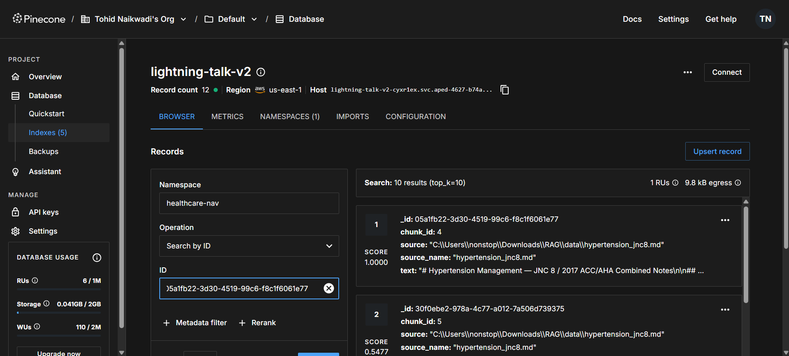
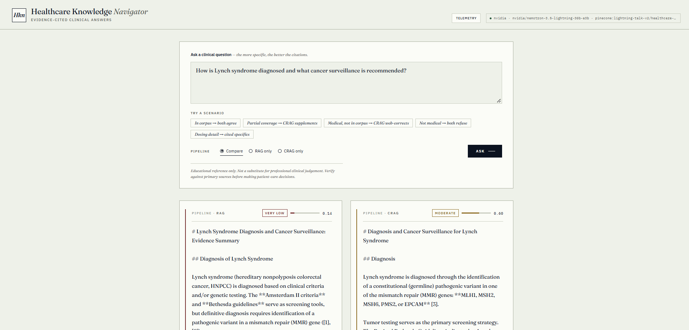
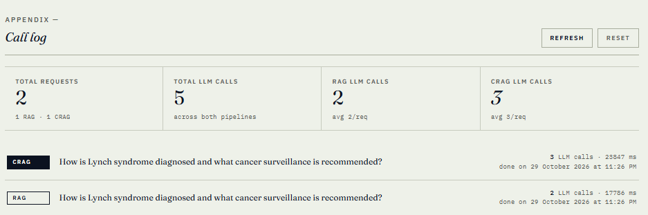
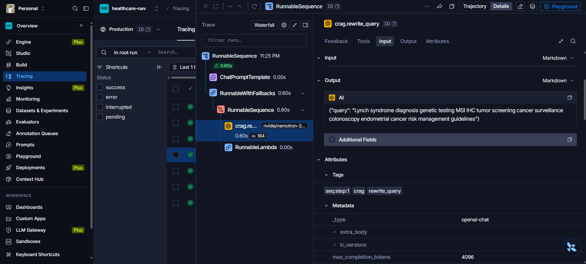

# Healthcare Knowledge Navigator

An evidence-based medical assistant that retrieves and synthesises information
from clinical guidelines, research papers, and treatment protocols. Ships **two**
pipelines side-by-side so you can watch them disagree:

1. **RAG** — retrieve → generate → confidence-score.
2. **CRAG (Corrective RAG)** — retrieve → grade each passage → optionally
   rewrite the query and pull the web via Tavily → generate → confidence-score.

| Layer | Technology |
|---|---|
| Backend | **FastAPI + Uvicorn**, streaming NDJSON |
| Frontend | plain **HTML / CSS / JavaScript** (no build step) |
| LLM + embeddings | **NVIDIA endpoints** via the OpenAI-compatible API (`nemotron-3.5-lightning-30b-a3b` chat, `nemotron-3.5-embed-1b` embeddings) |
| Vector DB | **Pinecone** (serverless, AWS `us-east-1`, cosine, **2048 dimensions**) |
| Web search | **Tavily** — CRAG's corrective fallback when the corpus can't answer |
| Tracing | **LangSmith** (optional) |
| Evaluation | **RAGAS** (offline harness + optional live scoring) |

> Educational reference only. Not a substitute for professional clinical
> judgement. Verify against primary sources before making patient-care decisions.

---

## What is RAG?

**Retrieval-Augmented Generation** grounds an LLM's answer in your own documents
instead of its training data:

1. **Ingest** — documents are split into chunks, each chunk is turned into a
   vector (embedding) and stored in a vector database (Pinecone here).
2. **Retrieve** — the user's question is embedded the same way and the `TOP_K`
   most similar chunks are pulled back.
3. **Generate** — those chunks are pasted into the prompt as context and the
   LLM writes an answer that cites them (`[1]`, `[2]`, …).

This gives answers that are current, auditable and specific to your corpus,
without retraining the model.

### The problem with plain RAG

RAG **trusts retrieval blindly**. The vector store always returns the `TOP_K`
nearest chunks — even when none of them is actually relevant. The LLM then
either:

- answers from irrelevant context (confidently wrong, with citations that look
  real), or
- falls back on its own memory and hallucinates.

There is no step that asks *"is what I retrieved actually good enough to
answer this?"* In a clinical setting that is the dangerous failure: a question
the corpus doesn't cover still gets a fluent, cited answer.

## What is CRAG?

**Corrective RAG** ([Yan et al., 2024](https://arxiv.org/abs/2401.15884)) adds a
self-check between retrieval and generation:

1. **Retrieve** from the vector store, exactly like RAG.
2. **Grade** each retrieved passage with an LLM: *is this relevant to the
   question?*
3. **Decide** based on how much survived grading:
   - mostly relevant → answer from the local documents;
   - partly relevant → **supplement** local documents with web results;
   - nothing relevant → **rewrite** the query for search and answer from the web.
4. **Web search** via **Tavily** when correction is needed.
5. **Generate** from the corrected context only.

### Why CRAG is needed

| Situation | RAG | CRAG |
|---|---|---|
| Question fully covered by the corpus | ✅ good answer | ✅ same answer (+1 grading call) |
| Corpus covers it partially | ⚠️ answers from half the evidence | ✅ fills gaps from the web |
| Medical, but not in the corpus | ❌ answers from irrelevant chunks | ✅ rewrites + web-corrects |
| Not medical at all | refuses | refuses |

CRAG pays for this with **one to two extra LLM calls and a web round-trip** per
query. That trade is worth it wherever a wrong-but-confident answer costs more
than a slower one. This app runs both side by side (**Compare** mode) so you can
watch exactly where they diverge.

---

## Screenshots

### 1. Pinecone (Vector DB)

Index `lightning-talk-v2` on AWS `us-east-1`, namespace `healthcare-nav`. The
index uses **2048 dimensions** with **cosine** similarity, which matches the
output width of `nvidia/nemotron-3.5-embed-1b`. Each record stores the chunk
text plus `source`, `source_name` and `chunk_id` metadata for citations.



### 2. Pipeline response — RAG vs CRAG

The same question ("How is Lynch syndrome diagnosed…") sent to both pipelines in
**Compare** mode. Lynch syndrome is **not** in the starter corpus. RAG answers
from weak local context (confidence **VERY LOW 0.14**). CRAG grades those
passages as irrelevant, rewrites the query, pulls evidence from the web via
**Tavily**, and answers with citations (**MODERATE 0.60**, the cap for web-only
answers).



### 3. LLM call log

The telemetry log at the bottom of the page counts the LLM calls behind each
request. RAG made **2** calls (classify + generate). CRAG made **3** (classify +
rewrite + generate) and spent extra time on the Tavily round-trip.



### 4. LangSmith traces

With `LANGSMITH_TRACING=true`, every step is traced to the `healthcare-nav`
project. Below is CRAG's `crag.rewrite_query` step turning the user's question
into a search-optimised query, which is then sent to **Tavily** for web search.



### 5. RAGAS evaluation — side-by-side scores

With `LIVE_EVALUATION=true`, the same Lynch syndrome question was scored in the
background with RAGAS (judge: `EVAL_MODEL`). The full report is in
[`RAG-Evaluation/evaluations/`](RAG-Evaluation/evaluations/).

| Metric | RAG | CRAG | Better | What it measures |
|---|---:|---:|---|---|
| **Overall RAGAS score** | **0.122** (poor) | **0.858** (excellent) | **CRAG** | Mean of the metrics below |
| `context_relevance` | 0.000 | 1.000 | **CRAG** | Retrieved passages bear on the question |
| `faithfulness` | 0.000 | 0.926 | **CRAG** | Share of answer claims supported by the retrieved passages |
| `response_groundedness` | 0.000 | 1.000 | **CRAG** | Answer is anchored in the retrieved passages |
| `answer_relevancy` | 0.487 | 0.507 | **CRAG** | Answer addresses the question that was asked |
| Route taken | weak-local | web_only | | Pipeline branch |
| Pipeline confidence | 0.14 (VERY LOW) | 0.60 (MODERATE) | | Pipeline's own heuristic |
| Latency | 17.8 s | 23.8 s | | |

RAG's grounding scores are zero because the corpus has nothing on Lynch
syndrome, so its answer isn't supported by anything it retrieved. CRAG swaps the
irrelevant chunks for Tavily web results and its answer is fully grounded in
them, at the cost of ~6 s of extra latency.

---

## 1. Setup

```powershell
# 1. Create + activate a Python 3.10+ venv
python -m venv ragenvironment
.\ragenvironment\Scripts\Activate.ps1
# If PowerShell says "running scripts is disabled", run once:
#   Set-ExecutionPolicy -Scope CurrentUser RemoteSigned

# 2. Install dependencies
pip install -r requirements.txt

# 3. Configure keys
copy .env.example .env
```

Then fill in `.env`. The required keys are `NVIDIA_API_KEY`
(<https://build.nvidia.com/>) and `PINECONE_API_KEY`
(<https://app.pinecone.io/>); the app refuses to start without them.
`TAVILY_API_KEY` (<https://tavily.com>, free tier available) is optional but
**CRAG cannot correct anything without it**. Tavily is the web search CRAG
falls back to, so without it the corrective path has nowhere to go and simply
refuses.

### Choosing models

NVIDIA retires models on a published end-of-life date, after which the endpoint
returns `410 Gone` and every request fails at retrieval. If that happens, run
`python list_models.py` to see what your key can currently reach, then update
`.env`. Two things to check before adopting a chat model:

- **It must support structured output (tool calling).** The CRAG passage grader
  and the medical-domain gate both depend on it.
- **Watch for hidden reasoning.** NVIDIA's hybrid-reasoning models (the
  `nemotron-3.5-*` family) emit a long internal reasoning pass by default, which
  can swallow the whole token budget — leaving an empty answer — and adds tens
  of seconds of latency. `MODEL_THINKING_ENABLED=false` (the default) turns that
  off and is what makes them fast.

**Changing `EMBEDDING_MODEL` is not a drop-in swap.** Vector width is fixed at
index creation, so a new embedding model means a new `PINECONE_INDEX`, a
matching `EMBEDDING_DIMENSION`, and a full re-ingest. Vectors written by one
embedding model are meaningless to another.

### Environment variables

| Variable | Default | Purpose |
|---|---|---|
| `NVIDIA_API_KEY` | — | **Required.** |
| `PINECONE_API_KEY` | — | **Required.** |
| `TAVILY_API_KEY` | — | Optional; enables the CRAG web-correction path. |
| `CHAT_MODEL` | — | Primary chat model. |
| `CHAT_MODEL_FALLBACK` | _(blank)_ | Tried only when the primary **errors or times out**. |
| `EMBEDDING_MODEL` | — | Must match `EMBEDDING_DIMENSION`. |
| `EMBEDDING_DIMENSION` | `2048` | Vector width of the embedding model (`nemotron-3.5-embed-1b` → 2048). |
| `PINECONE_INDEX` | `lightning-talk-v2` | Index name; created by `ingest.py` if missing. |
| `PINECONE_NAMESPACE` | `healthcare-nav` | Namespace the chunks are written to. |
| `LIVE_EVALUATION` | `true` | Score every UI question with RAGAS in the background (needs `requirements-eval.txt`). |
| `MODEL_THINKING_ENABLED` | `false` | Leave off unless a model needs reasoning. |
| `EVAL_MODEL` | `openai/gpt-oss-20b` | Judge model for `evaluate.py` only (see Evaluation). |
| `LLM_TIMEOUT_SECONDS` | `60` | Per-request timeout. |
| `LLM_MAX_RETRIES` | `2` | SDK-level retries, per model. |
| `WARMUP_ON_STARTUP` | `true` | One embedding + one tiny LLM call at boot. |
| `TOP_K` | `5` | Passages retrieved per query. |
| `TOPIC_SCORE_THRESHOLD` | `0.20` | Below this, the domain gate runs (see below). |
| `CHUNK_SIZE` / `CHUNK_OVERLAP` | `1000` / `150` | Ingestion chunking. |
| `LANGSMITH_TRACING` | `false` | Set `true` **and** supply a valid key, or every call logs a 403. |

## 2. Ingest documents

Drop `.md`, `.txt`, or `.pdf` clinical documents into `./data/` (a starter corpus
of ADA T2DM, GINA asthma, hypertension, sepsis, and AF anticoagulation is
included). Then:

```powershell
python ingest.py
```

This creates the Pinecone index if it doesn't exist and upserts the chunks.

## 3. Run the web app

```powershell
.\ragenvironment\Scripts\Activate.ps1     # if not already active
uvicorn server:app --reload
```

Open <http://127.0.0.1:8000>. Pick **Compare**, **RAG only**, or **CRAG only**,
then either type a question or click one of the **Try a scenario** chips, which
are pre-written to exercise each routing path.

Each answer shows the synthesised text with inline `[1] [2]` citations, a
confidence label, expandable citation snippets, and the live reasoning trace.
A telemetry dashboard lives at `/dashboard`.

---

## Architecture

> **Note:** despite `langgraph` appearing in `requirements.txt`, these pipelines
> are **not** built with `StateGraph`. They are hand-rolled async generators
> composed from LangChain runnables (`chain = PROMPT | llm`), which is why they
> stream cleanly but have no checkpointing, replay, or resumability.

```
data/*.md,*.pdf ──► ingest.py ──► Pinecone (NVIDIA embeddings)
                                       │
                                       ▼
        ┌────────────────────────────────────────────────┐
        │  RAG:   retrieve ─► [gate] ─► generate          │
        │                                                 │
        │  CRAG:  retrieve ─► [gate] ─► grade ─► decide    │
        │           ├─ generate                           │
        │           └─ rewrite ─► web_search ─► generate   │
        └────────────────────────────────────────────────┘
                             │
                             ▼
          FastAPI (NDJSON stream)  ◄──►  HTML/CSS/JS frontend
```

Blocking I/O (Pinecone, Tavily) runs via `asyncio.to_thread` and LLM steps use
`ainvoke`/`astream`, so in Compare mode the two pipelines genuinely run
concurrently rather than queueing behind each other.

### The topic gate

A naive similarity threshold cannot tell *"not medicine"* from *"medicine my
corpus doesn't cover"* — and those deserve opposite handling. Measured against
the starter corpus, a sourdough recipe scores **0.130** while "what is
hereditary cancer" scores **0.033**; cosine alone ranks the bread as more
on-topic. So the gate is two-stage:

| Retrieval score | Then | RAG | CRAG |
|---|---|---|---|
| ≥ `TOPIC_SCORE_THRESHOLD` | proceed directly (no extra call) | generate | grade → decide |
| below, **not** medical | — | refuse | refuse |
| below, **is** medical | one cheap classification call | answer from weak context (honest baseline) | skip grading → web-correct |

The classifier only runs on the weak-retrieval path, so the common case stays at
one LLM call for RAG. If the classifier itself fails it **fails closed** — the
question is refused rather than answered on a guess.

### Confidence scoring

Confidence is derived from the **top retrieval cosine similarity**
(`min(1.0, top_score * 1.2)`), not from an LLM self-audit — an earlier version
asked the model to grade its own grounding and it was not a reliable judge.

- HIGH ≥ 0.80 · MODERATE ≥ 0.55 · LOW ≥ 0.30 · VERY LOW < 0.30

CRAG caps confidence at `0.6` when answering purely from web results, since
those sources aren't part of the vetted corpus.

> **Known limitation:** because the score comes from *local* retrieval, a
> web-corrected answer inherits the low score of the corpus passages CRAG
> deliberately discarded. A well-sourced web answer can therefore display
> `VERY LOW` next to genuinely good citations.

### CRAG routing

A per-passage LLM grader labels each retrieved chunk `yes` / `no`, and the
router picks an action from the fraction found relevant:

| Ratio of relevant docs | Action |
|------------------------|--------|
| = 0 | rewrite query, answer purely from web results |
| < 0.5 | supplement local docs with web results |
| ≥ 0.5 | answer directly from local docs |

Grading **fails open**: if the grader errors, all passages are kept rather than
discarding evidence on an infrastructure failure.

### Cost per query

| Path | LLM calls |
|---|---|
| RAG, in corpus | 1 (generate) |
| RAG, weak retrieval | 2 (classify + generate) |
| CRAG, in corpus | 2 (grade + generate) |
| CRAG, correction path | 3 (grade/classify + rewrite + generate) |
| Refused as off-topic | 1 (classify) |

Passage grading is a single batched call over all `TOP_K` passages, not one per
passage, and grading never runs on the same query as domain classification —
the gate picks one branch or the other. **[CRAG-FLOW.md](CRAG-FLOW.md)** has the
full step-by-step diagram and the per-path call accounting.

### API

| Method | Path | Description |
|--------|------|-------------|
| GET | `/` | HTML UI |
| GET | `/dashboard` | Telemetry dashboard |
| GET | `/api/health` | Status, active models, index, feature flags |
| POST | `/api/ask` | Non-streaming; returns the whole answer |
| POST | `/api/ask/stream` | **Used by the UI.** NDJSON event stream |
| GET | `/api/traces` | Aggregate LLM-call telemetry + history |
| POST | `/api/traces/reset` | Clears trace history |

Both ask endpoints take `{ "question": "...", "mode": "rag" | "crag" }`.
`/api/ask/stream` emits one JSON object per line:

```jsonc
{"type": "trace", "message": "retrieved 5 passages (top cosine 0.57)"}
{"type": "token", "text": "SGLT2 inhibitors "}
{"type": "meta",  "citations": [...], "confidence": 0.68, "confidence_label": "MODERATE"}
{"type": "done"}
```

Swagger docs at `/docs`.

> `/api/traces/reset` is unauthenticated — fine locally, but gate it before
> exposing this anywhere.

### Project layout

| File / dir | Purpose |
|---|---|
| `server.py` | FastAPI app: routes, pipeline lifecycle, startup warm-up |
| `ingest.py` | Loads `./data`, chunks, embeds, upserts to Pinecone |
| `list_models.py` | Lists models your NVIDIA key can reach |
| `list_traces.py` | Lists recent LangSmith runs + prints the UI link |
| `evaluate.py` | Offline RAG-vs-CRAG scoring harness (see Evaluation) |
| `ragas_compat.py` | RAGAS import shim + evaluator-LLM factory |
| `eval/` | `golden_set.json` + timestamped `results-*.json` |
| `verify_pinecone.py` | Connectivity / index sanity check |
| `src/config.py` | Env-driven `Settings` (fails fast if a key is missing) |
| `src/document_loader.py` | Recursive load + chunk of md/txt/pdf |
| `src/vector_store.py` | Pinecone index create / load, NVIDIA embeddings |
| `src/rag_agent.py` | Baseline RAG pipeline |
| `src/crag_agent.py` | Corrective RAG (grading + web fallback) |
| `src/utils.py` | LLM factories, topic gate, citation + confidence helpers |
| `src/telemetry.py` | In-process LLM-call counter behind `/api/traces` |
| `static/` | Single-page UI + telemetry dashboard |
| `data/` | Source documents (starter corpus included) |
| `RAG-Evaluation/` | Live RAGAS scoring of UI questions; reports in `evaluations/` |
| `docs/screenshots/` | Images used in this README |

## Evaluation

`evaluate.py` is an offline harness that scores both pipelines against a fixed
golden set, so "RAG vs CRAG" is a table of numbers rather than an anecdote.

```powershell
pip install -r requirements-eval.txt     # ragas only; kept out of requirements.txt
python evaluate.py                       # full golden set, both pipelines
python evaluate.py --limit 4             # first 4 questions (quick iteration)
python evaluate.py --mode crag           # one pipeline
python evaluate.py --category not-in-corpus
```

It imports `RAGPipeline` / `CRAGPipeline` directly, so no server needs to be
running. Each run prints a per-category summary and a per-question detail
table, and writes `eval/results-<UTC timestamp>.json` with every answer,
context, citation, trace and score, so runs stay comparable over time.

**The golden set** (`eval/golden_set.json`) holds 12 questions in four
categories: `in-corpus` (answerable from `./data`), `not-in-corpus` (medical,
zero coverage — the interesting case), `partial` and `off-topic`. A question
carries a `reference` answer only where a defensible ground truth can be
written; where it is `null`, `AnswerAccuracy` is skipped for that row and only
the two reference-free metrics apply.

**The metrics** are the NVIDIA set from RAGAS, via the `ragas.metrics.collections`
API:

| Metric | Inputs | What a low score means |
|---|---|---|
| `ContextRelevance` | question + retrieved contexts | Retrieval pulled passages that do not bear on the question. |
| `ResponseGroundedness` | answer + retrieved contexts | The answer asserts things its own evidence does not support — confabulation. |
| `AnswerAccuracy` | question + answer + reference | The answer disagrees with the ground truth. |

The contexts scored are the ones the answer was actually generated from: for
CRAG that is the post-grading set (kept local passages plus web documents),
never the raw pre-grading retrieval it discarded. Both pipelines publish that
set on their `meta` event.

**The judge** is `EVAL_MODEL` (default `openai/gpt-oss-20b`), deliberately a
different model from `CHAT_MODEL`: scoring an answer with the model that wrote
it inflates every number.

### Limitations — read these before quoting the table

- **12 questions.** Per-category means rest on 1–6 questions each. Treat large
  gaps as signal and small ones as noise.
- **One judge model, LLM-as-judge.** The scores are one model's opinion, they
  are not reproducible to the decimal between runs, and they inherit that
  model's own blind spots. Re-running the same set will move the numbers.
- **Coarse scale.** These metrics return a small set of discrete values, so a
  single question can swing a category mean by a visible amount.
- **No latency or cost dimension.** CRAG buys its correction with extra LLM
  calls and a web round-trip; the table does not price that in.
- **References are hand-written**, so `AnswerAccuracy` measures agreement with
  this repo's reading of the corpus, not with the literature.

## Docker

```powershell
docker compose up --build                          # app on :8000
docker compose --profile ingest run --rm ingest    # one-shot ingestion
```

Secrets come from `.env` and are never baked into the image.

## Troubleshooting

| Symptom | Cause |
|---|---|
| `410 Gone` on every question | Model retired. Run `list_models.py`, update `.env`. |
| `Pinecone index ... does not exist` | Run `python ingest.py` first. |
| Empty answers, `finish_reason: length` | Reasoning model eating the budget. Set `MODEL_THINKING_ENABLED=false`. |
| `403 Forbidden` from LangSmith on every call | Invalid key. Replace it or set `LANGSMITH_TRACING=false`. |
| Dimension mismatch on upsert | `EMBEDDING_DIMENSION` ≠ the model's width, or index built for a different model. |

## Extending the corpus

- Drop new files under `./data/` (nested directories are fine).
- Re-run `python ingest.py`.
- PDFs are page-aware — page numbers appear in citations.
